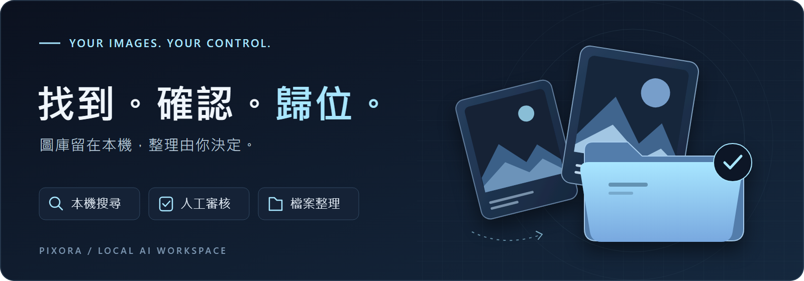
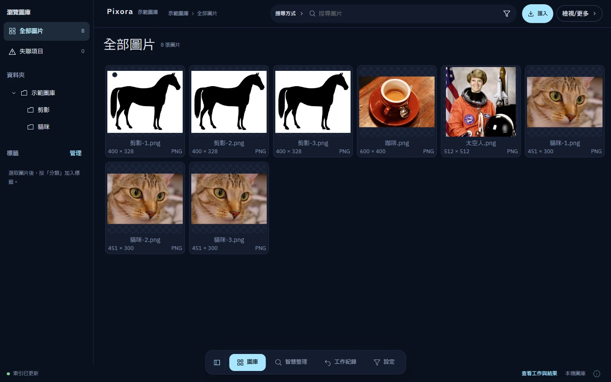
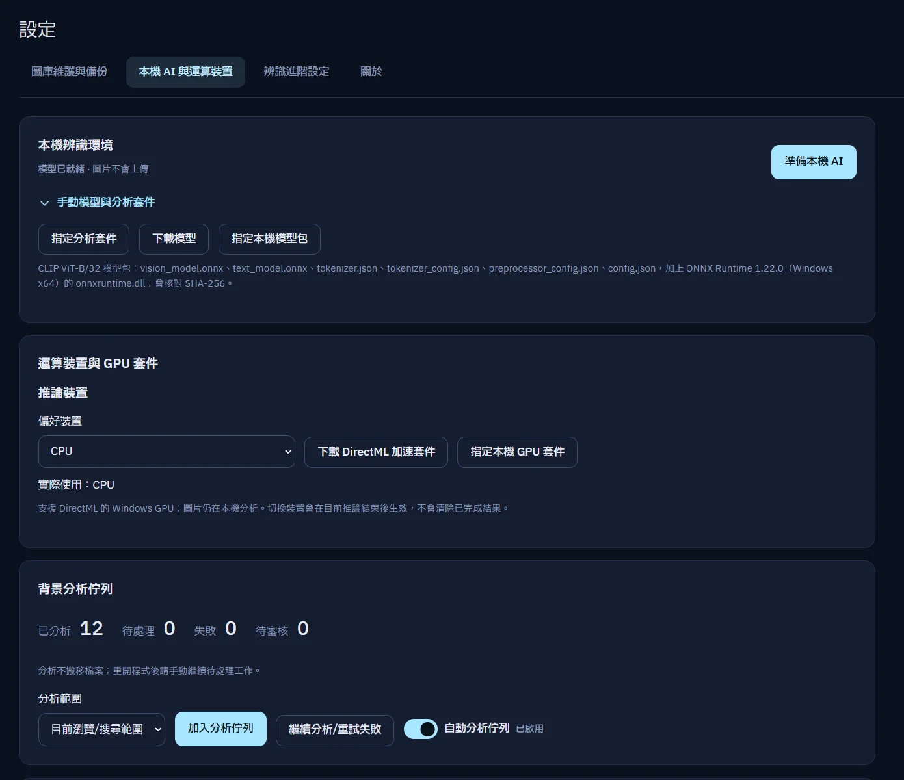
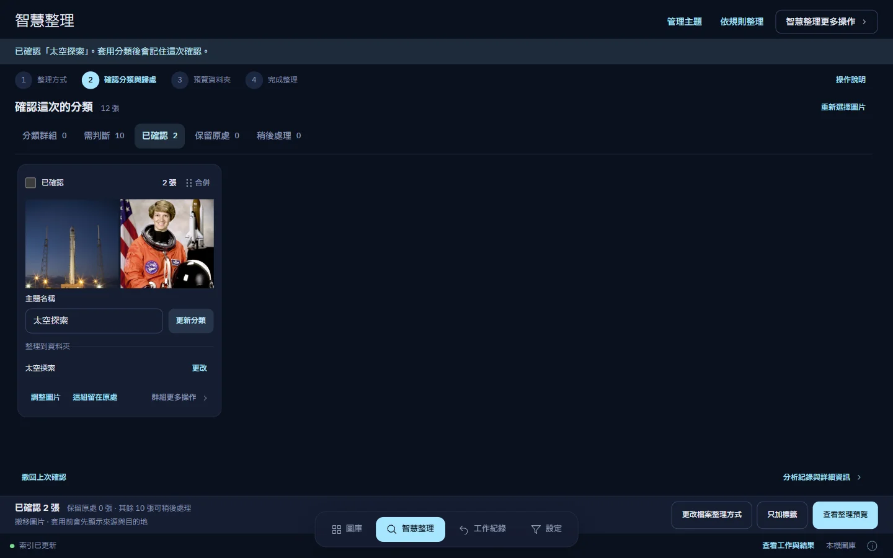

  

<h1 align="center">Pixora</h1>

  <strong>讓每張圖片，各得其所。</strong> 
  用本機 AI 找回圖片，經過你的確認，再整理到真正的資料夾。

  
  
  

  <a href="https://github.com/LiuTouo/Pixora-releases/releases/latest"><strong>下載 Windows 版</strong></a>
  &nbsp; · &nbsp;
  <a href="https://liutouo.github.io/Pixora-releases/">產品網站</a> 
  
    <a href="#第一次使用">使用指南</a>
    &nbsp; · &nbsp;
    <a href="#工程設計">工程設計</a>
    &nbsp; · &nbsp;
    <a href="https://github.com/LiuTouo/Pixora-releases/issues">回報問題</a>
  

  

## 從找到圖片，到整理好圖庫

記得畫面，卻想不起檔名？Pixora 讓你以圖片內容尋找線索，用標籤與資料夾建立秩序，再把確認過的整理計畫套用到磁碟。**AI 提供建議，檔案的歸處由你決定。**

<table>
  <tr>
    <td width="50%" valign="top">
      <strong>本機語意搜尋</strong> 
      用英文描述或相似圖片找圖，推論不需上傳圖片。
    </td>
    <td width="50%" valign="top">
      <strong>熟悉的資料夾</strong> 
      沿用既有圖庫，以標籤、收藏與星等補充分類。
    </td>
  </tr>
  <tr>
    <td valign="top">
      <strong>先審核，再套用</strong> 
      確認分類與目的地，預覽逐檔影響後才執行。
    </td>
    <td valign="top">
      <strong>有紀錄，可復原</strong> 
      智慧整理保留跨重啟紀錄，遇到衝突不任意覆寫。
    </td>
  </tr>
</table>

   
  圖庫瀏覽 · v0.3.7 同版本測試建置 · <a href="https://liutouo.github.io/Pixora-releases/">開啟互動產品導覽</a>

> [!NOTE]
> 此儲存庫提供 **Windows 發行檔與公開產品文件**，不提供產品原始碼。操作說明與截圖以已驗證的 **v0.3.7** 為準；下載連結始終前往最新發行版。

## 下載與安裝

前往 **[最新發行版](https://github.com/LiuTouo/Pixora-releases/releases/latest)**，在 Assets 選擇適合的版本：

| 安裝版 | 免安裝版 |
| --- | --- |
| 下載 `*-setup.exe`，依安裝程式指示完成設定。 | 下載 `*-portable.zip`，**完整解壓縮**到可寫入的資料夾，再開啟 `Pixora.exe`。 |
| 適合希望直接安裝使用的人。 | 必須保留隨附的 `analysis` 資料夾，不要只取出執行檔。 |

**不需另外安裝 Python、Rust 或 Node.js。**

- **系統** — Windows x64，已測試 Windows 11；需要 Microsoft WebView2 Runtime。
- **運算** — GPU 為選配，可使用 DirectML 加速；無法使用 GPU 時回到 CPU。
- **連線** — 初次下載模型與選用的 GPU 套件需要網路；備齊後可離線推論。基本圖庫瀏覽不需先下載模型。

請確認下載來源是此儲存庫的 Releases。若安全軟體提出警示，先核對來源與警示內容，**不要停用安全保護**。

## 第一次使用

建議先選一個**已備份的小資料夾**，熟悉流程後再整理主要圖庫。

1. **登錄圖庫**

   選擇「建立圖庫」或「開啟既有資料夾」。Pixora 只索引登錄的圖庫；原圖留在你選擇的真實資料夾。

2. **瀏覽與分類**

   從「圖庫」瀏覽資料夾，雙擊圖片即可預覽。標籤、收藏、星等不改變檔案位置；搬移與改名則會實際改動磁碟上的檔案。

3. **準備本機 AI**

   開啟 **設定 → 本機 AI 與運算裝置**，準備模型與運算環境。GPU 套件也在這裡設定，沒有 GPU 可使用 CPU。

4. **建立搜尋資料**

   在同頁「背景分析佇列」選擇範圍，按「加入分析佇列」，等待圖片分析完成。**模型就緒不代表圖片已完成分析**；背景分析建立搜尋資料，不會搬檔。

5. **用內容找回圖片**

   回到圖庫，在「搜尋方式」選語意搜尋，輸入英文描述，例如 `a photograph of a cat`；也可從圖片資訊尋找相似圖片。一般文字搜尋比對檔名與相對路徑。

<strong>查看本機 AI 與運算裝置設定畫面</strong>

  

## 先確認，再整理

智慧整理把「分析」與「搬檔」分開，讓每一步的影響都能先被看見。

| Step | 操作重點 |
| --- | --- |
| **01** | **選範圍** — 選擇圖片、資料夾、整理方式，以及要保留原處的集合。 |
| **02** | **人工審核** — 確認分類群組、命名與目的地；不確定的圖片可以稍後處理。此時尚未搬檔。 |
| **03** | **預覽並套用** — 核對逐檔目的地與實際影響，再確認執行。只加標籤也會先預覽。 |
| **04** | **結果與復原** — 查看完成結果，或從「最近操作」復原。紀錄跨重啟保存；遇到原位置被占用或檔案已變更時，會列出衝突，不任意覆寫。 |

**[探索整理與復原 →](https://liutouo.github.io/Pixora-releases/#feature-recovery)**

<strong>查看智慧整理的審核畫面</strong>

  

## 檔案、隱私與復原邊界

> [!IMPORTANT]
> **管理資料備份，不等於原圖備份。**「設定 → 圖庫維護與備份」匯出的內容不包含原始圖片；整理前，請另外備份原圖。

- **本機推論**：圖片不會上傳做 AI 推論；初次下載模型仍需連線。
- **一般搬移／改名**：`Ctrl+Z` 只復原本次工作階段的操作。
- **智慧整理**：使用持久化操作紀錄復原，可跨重啟；仍需核對檔案狀態，不保證能覆蓋後續變更。
- **刪除圖片**：請從 Windows 回收筒還原，並非上述 Undo。

## 工程設計

不只找出相似圖片，也處理本機資源、可追溯狀態與檔案安全。

- **介面與運算分工** — React／TypeScript 呈現桌面介面；Rust 協調檔案、SQLite 與本機索引。
- **搜尋與分類管線** — CLIP＋ONNX 產生圖片／文字向量，USearch／HNSW 搜尋後以 SQLite 對應圖片；PCA／HDBSCAN 輔助未知內容群聚，最終分類仍經人工審核。
- **可恢復的操作設計** — GPU／CPU 備援、內容與模型版本快取、可重建索引，以及預覽、衝突核對與持久化復原。

**[查看核心量測資料 →](docs/evidence/benchmark-1000000.json)** · **[查看畫面擷取與操作驗證 →](docs/evidence/capture-provenance.json)**

歷史核心量測（2026-09-17）以 512 維合成向量量測 100 萬筆「ANN 搜尋 + SQLite ID lookup」，不含模型推論與 UI。Recall@50 是對精確向量搜尋的召回率，不是圖片分類正確率，也不是百萬張真實圖片的產品效能。完整百萬張真實圖片的端到端驗收尚未完成。

量測環境：Windows 11 · Ryzen 7 9800X3D · 約 32 GiB RAM · 4 threads · 200 queries。

## 回報問題

請到 **[Issues](https://github.com/LiuTouo/Pixora-releases/issues)** 提供使用版本、重現步驟與錯誤訊息。附上截圖或紀錄前，請先遮蔽私人圖片、路徑及其他個人資訊。

## 素材來源

<strong>畫面版本、示範資料與素材來源</strong>

產品截圖來自 **v0.3.7 同版本、隔離的 debug 測試建置**，內嵌 production 前端，以 CDP 擷取；不是未發行的新介面。

- 使用真實 CPU 推論，展示 **12 張不同圖片**。智慧整理初步結果皆需人工判斷；由人選取太空人與火箭，確認「太空探索」，不宣稱自動分類成功。
- 實際搬移並復原 2 個檔案，以 SHA-256 驗證內容與位置；這是小型操作示範，**不是辨識準確率 benchmark**。
- [63 秒真實操作影片](https://liutouo.github.io/Pixora-releases/#demo)：連續擷取 WebView 畫面，約每秒 5 張畫面，僅剪去片尾停留；模型、CPU 分析與初步智慧整理在錄影前完成。網站動畫不代表原影片的錄製幀率。
- [繁體中文字幕（VTT）](docs/assets/demo.zh-TW.vtt) 已改為操作導引，保留原有九段時間碼、人工確認事實與原圖備份提醒；影片、截圖及操作驗證資料不變。
- [查看擷取紀錄、逐張來源授權與驗證](docs/evidence/capture-provenance.json)。

示範素材經由 [scikit-image data](https://scikit-image.org/docs/stable/api/skimage.data.html) v0.25.2，皆為 CC0／公有領域，涵蓋動物、咖啡、攝影師、太空人、火箭、星系、時鐘與材質；未以複製或裁切變體增加數量。每張作者、授權依據、來源及雜湊見上述擷取紀錄。

Pixora 圖示沿用提供的品牌素材；README banner 為流程概念插畫，並非產品介面。[可編輯 SVG 原稿](docs/assets/readme-banner.svg)。

---

  <strong>圖片留在你的電腦，決定權也一樣。</strong> 
  <a href="https://github.com/LiuTouo/Pixora-releases/releases/latest">下載 Pixora</a>
  &nbsp; · &nbsp;
  <a href="https://liutouo.github.io/Pixora-releases/">探索產品網站</a>

